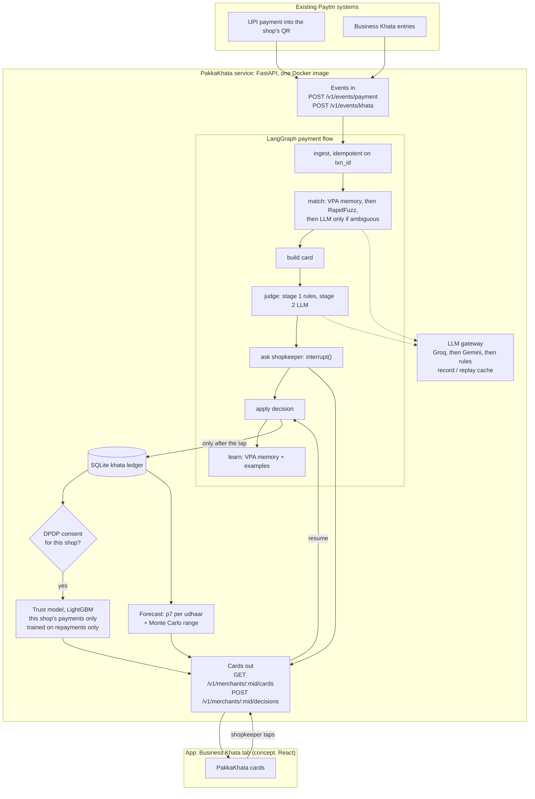

# PakkaKhata

**Other apps track who owes you. PakkaKhata shows who to trust.**

A helper for the Business Khata tab in Paytm for Business. It reads UPI payments arriving at a shop's QR and gives
the shopkeeper three cards. It never acts on its own: it suggests, and the shopkeeper taps.

| Card | What the shopkeeper sees |
|---|---|
| **Who paid you** | "Ramesh dudh wala paid ₹450. On PhonePe. Clear the ₹450 udhaar?" [Clear ₹450] [Just a purchase] [Not this customer] |
| **Who to trust** | "Lakshmi N paid you 26 times in the last 6 months and has no udhaar on record. Visits on a steady schedule and never away more than 9 days. Allow Lakshmi N udhaar up to ₹100?" ✓ Agreed to share their payment record with this shop. [Yes, allow ₹100] [No] |
| **What's coming back** | "About ₹20,300 of the ₹38,000 udhaar should come back in the next 7 days (likely ₹11,500 to ₹28,300)." |

Built for the Paytm Build for India AI Hackathon (Track 1, Merchant Growth AI).
**All data is synthetic**, shaped on the published findings of Sungu, Alhorr & Srivastava (2026), a field experiment in
26 Mumbai grocery stores. No real customers, no real Paytm integration, no money moves.

---

## Evidence (India first)

- **Problem:** a 2026 field study in 26 Mumbai kiranas (Sungu, Alhorr & Srivastava) found that about half of owners keep no written records and spend about 8 hours a week chasing repayments.
- **Scale:** NSO All India Debt & Investment Survey 2019 (NSS 77th round), [MoSPI press note, 24 Aug 2021](https://www.mospi.gov.in/sites/default/files/press_release/press_note-AIDIS-240821.pdf): of households' outstanding cash debt, 34% in rural India and 13% in urban India came from non-institutional credit agencies (institutional: 66% rural, 87% urban). The press note doesn't break this down by shopkeepers.
- **Compliance:** DPDP consent (only customers who agreed to share their payment record with that shop are scored or suggested); no money movement (no payments, no payment or collect requests, no messages to customers; the only write is a khata entry after the shopkeeper taps); per-shop scoring (each shop's scores use only its own payments and are shown only to that shop). Checked by tests in `tests/test_compliance.py` and `tests/test_recommend.py`.
- **Names:** tested on 60 hand-written Indian name pairs (transliteration, v↔b, initials, reordering, honorifics, descriptors, blank UPI names, hard negatives): precision at auto-match 97.1%, false-match rate 5% (1 of 20 different-person pairs). Different people with near-identical names in one shop never auto-matched. Variation types from IDinsight's work on Hindi name matching; their code was not copied. Also checked on real spelling variation in AI4Bharat Aksharantar (Hindi and Telugu words, not names; 3,000 pairs each): two Latin spellings of the same word auto-matched 62.6% (Hindi) / 68.4% (Telugu) of the time and went to the LLM or shopkeeper most of the rest; different look-alike words auto-matched 4.7% / 5.7% (`reports/aksharantar_metrics.json`; licence per the dataset card: CC-BY / CC0 by source, cite arXiv:2205.03018).
- **Honest limit:** No open Indian customer-level transaction or credit dataset exists; the next step is a consented pilot on Paytm merchants.

---

## Run it

**Docker (recommended, works offline):**
```bash
docker build -t pakkakhata .
docker run -p 8000:8000 pakkakhata        # open http://localhost:8000  ·  API docs at /docs
```

**Local (Python 3.11 + Node 20+):**
```bash
python3.11 -m venv .venv && .venv/bin/pip install -r requirements.txt
cd web && npm ci && npm run build && cd ..
.venv/bin/python data/generate.py          # seeded data + models + reports (~70 s)
.venv/bin/uvicorn api.main:app --port 8000
```
On macOS without Homebrew, LightGBM can't find `libomp`. Run `bash scripts/fix_lightgbm_macos.sh` once (or `brew install libomp`).

**Deploy (Railway):** push the repo and create a service from it. `railway.json` builds the Dockerfile and health-checks
`/health`; Railway sets `$PORT`. Set `DEMO_ROUTES=true` for the demo console, and `DEMO_OPEN_ADMIN=false` plus an
`ADMIN_KEY` if you don't want visitors pressing Reset. Vercel and Cloudflare aren't a fit for the backend: the
LangGraph pause/resume keeps paused threads in a long-running process, the ledger is SQLite on disk and LightGBM is native.

**Tests:** `.venv/bin/python -m pytest` (146 tests, offline, including the full 8-payment demo as one snapshot test).

**LLM modes** (set in a local `.env` file, which is never committed: `GROQ_API_KEY=`, `GEMINI_API_KEY=`, `DEMO_MODE=replay|live|record`, optional `SHOP_KEYS` and `ADMIN_KEY`): `DEMO_MODE=replay` (default) uses cached answers and rules and never touches
the network. `live` calls Groq (`openai/gpt-oss-120b`), then Gemini Flash (model ID resolved at runtime from the model
list), then rules. `record` does the same and saves answers to `cache/llm_cache.json` for replay. To refresh the cache: put your keys in `.env` (never in a tracked file), then `DEMO_MODE=record .venv/bin/python scripts/record_demo.py`. The committed cache was recorded with Groq; the judge's stage 1 rejects any rephrase that drops an amount or the question, so Groq's Hinglish is shown only on cards where it kept both (in the recorded run: the payment cards).

---

## How it works



- **Nothing moves money and nothing messages customers.** No payments, no payment or collect requests; the only writes are khata entries after the shopkeeper taps.
- **Events in, cards out.** The web app's phone screen renders `GET /v1/merchants/{mid}/cards`, the same endpoint Paytm's app team would call. Each response is under 5 KB.
- **The LLM never writes to the ledger.** It proposes; deterministic code validates (the answer must be one of the supplied candidate ids); the shopkeeper confirms; only then does the ledger change (`apply_decision`, after LangGraph resumes).
- **Money is integer paise.** ₹ with Indian lakh grouping only at the edge (`core/money.py`, `web/src/lib.ts`).
- **No personal attributes in the trust model.** No names, group, gender or location. Names are used only to match identity.

| Piece | Where |
|---|---|
| Name matching (Ramesh dudh wala ↔ RAMESH K), in-context learning from the shop's confirmed matches | `core/normalize.py`, `core/matcher.py` |
| Human-in-the-loop: LangGraph `interrupt()` / `Command(resume=…)` | `core/graph.py` |
| Hidden regulars: LightGBM trust score + plain-word reasons from `pred_contrib` | `core/features.py`, `core/trust_model.py`, `core/recommend.py` |
| Udhaar limit ladder ₹100 → ₹200 → ₹400 → ₹700 → ₹1,000 (our design) | `core/ladder.py` |
| Repayment range: p7 model + seeded Monte Carlo with a shared weekly shock | `core/forecast.py` |
| LLM-as-judge: stage 1 deterministic, stage 2 LLM | `core/judge.py` |
| One LLM gateway: Groq → Gemini → rules, record/replay cache | `core/llm.py` |
| Bias experiment, self-improving loop | `core/bias_experiment.py`, `core/learning.py` |
| API (integration contract + demo console) | `api/main.py` |
| Web app (React + TypeScript + Tailwind + Recharts) | `web/` |

Beyond the deck's tech slide, the build also uses **SQLite** (ledger), **Pydantic** (validates every LLM output and API body),
**NumPy** (forecast range), **pytest**, **React/Tailwind/Recharts** (web app) and **fairlearn** (fairness audit on real credit data).

---

## Results (from real runs, files in `reports/`)

**Bias experiment** (`reports/bias_experiment.json`, `reports/bias_sweep.json`). Two models with the same features:
Model A learns the shopkeeper's past yes/no, Model B learns actual repayments. On 40 held-out shops, the share of
truly reliable customers who get recommended:

| | In-group | Out-group | Gap | 95% CI (bootstrap by shop) |
|---|---|---|---|---|
| Shopkeeper's own choices | 32.5% | 21.3% | **+11.2 pts** | — |
| Model A (learns his yes/no) | 26.1% | 29.4% | −3.3 pts | [−8.2, +1.0] |
| Model B (learns repayments) | 26.8% | 27.0% | **−0.1 pts** | [−4.2, +3.8] |

Model A can only copy the shopkeeper's bias through a proxy, here basket size (in-group customers buy slightly bigger
baskets in the generator; this is unrelated to repayment). Sweeping that proxy's strength over 3 seeds, Model A's
gap grows from −1.5 to **+14.0 pts** while Model B stays between 0 and +3 pts. In the app's default world the proxy is
weak, so Model A shows no clear gap. We report that rather than tuning the data until it does. Model A predicts
repayment slightly better (AUC 0.72 vs 0.71); it trains on about 5× more rows.

**Trust model** (`reports/metrics.json`): held-out-shop ROC-AUC **0.69**, against an oracle ceiling of **0.77** (the
best any model could do in this synthetic world). Brier 0.156 vs 0.168 for a base-rate guess. The threshold (0.947)
was picked on validation shops for ~90% precision. On test shops, people with no credit history above the threshold
repaid on time 83% of the time (base rate 71%, n = 23).

**Forecast** (`reports/forecast_metrics.json`): p7 AUC 0.78. The 80% range held the real total in **96%** of 612
held-out shop-weeks, so it is conservative.

**Matcher learning loop** (`reports/learning_matcher.json`): over 4 replayed weeks, VPA-memory resolutions went 0 → 10 → 28 → 28
and auto-resolved repayments went 60% → 58% → 76% → 74%, with zero wrong customers proposed.

**Indian name matching** (first validation task, `reports/matcher_metrics.json`): 60 labelled pairs, precision at auto-match **97.1%**, false-match rate **5%** (the one false match is "DURGA PRASAD" vs "Durga amma", which names alone can't separate; the shopkeeper's tap catches it), recall 85%. A second set of 62 shop-level cases checks that different people with near-identical names stay ambiguous: none auto-matched.

**Foreign method checks** (`experiments/`; not Indian data, not kirana repayments):
- *UCI Online Retail II*: UK retail data, used only to sanity-check the feature method; not Indian, not repayment data. With our behaviour features, "buys again within 90 days" gives ROC-AUC 0.80 vs 0.76 for recency alone (PR-AUC 0.71 vs 0.60); trained at an earlier cutoff and scored later, 0.79. CC BY 4.0.
- *UCI Default of Credit Card Clients*: Taiwan credit-card data (2005), used only to check the fairness-audit method; not Indian. Equal-opportunity difference 1.3 pts by sex, 6.2 pts by age band (AUC 0.78). It has no shopkeeper decisions, so it doesn't replicate Model A vs B. CC BY 4.0.

Run them with `pip install -r requirements-validation.txt && python experiments/download.py && python experiments/real_retail.py && python experiments/fairness_external.py && python experiments/matcher_eval.py`.
Licences and SHA-256 checksums are in `reports/dataset_manifest.json`. Raw files aren't committed.

---

## Honest limitations

- **Synthetic data.** The demo shops and the 200 training shops are generated (`data/generate.py`, seed 42), with parameters shaped on the study's published findings (`facts.py`): the 82nd-percentile credit threshold, +42% in-group favouritism, and random small borrowers being no riskier. We never had the study's data (AEA RCT registry: not public).
- **How strongly behaviour predicts repayment is an assumption** of the synthetic world (`f(r)`, a logistic curve). That's why the oracle ceiling is reported next to every AUC. Real performance is unknown until a pilot.
- **The bias result depends on proxy strength**, which is unknown in the real world. The sweep shows the whole range.
- **The forecast range is conservative** (96% coverage for an 80% range).
- **The deck's ₹24,000 forecast story became ₹20,300.** The app's real number wins.
- **Hindi/Telugu**: only strings checked by a native speaker ship. Drafts in `app/i18n_drafts_unreviewed.json` are never loaded.
- **Production would change:** Paytm merchant login instead of `X-Shop-Key`; Postgres and a persistent LangGraph checkpointer instead of SQLite/InMemorySaver; mapping to Paytm's internal event schema (a pilot task; we don't claim to know it); consent captured in the Paytm app's own flow (PakkaKhata never messages customers); `DEMO_ROUTES=false`.

## Security

Keys live only in `.env` (git-ignored; `config.py` falls back to replay if they're missing). Every SQL query is
parameterised. Every endpoint and query is scoped to one merchant (tested). API bodies and LLM outputs are validated
by Pydantic with limits. Payer names are wrapped as data in prompts. VPAs are masked everywhere (`98******45@ybl`).
CORS is limited to the dev origin. There's a per-key rate limit, security headers, and admin routes behind a key.
`bandit` reports 0 medium/high issues, `pip-audit` finds no known vulnerabilities, and the git history has been scanned for keys.
There are no passwords because there are no user accounts; production would use Paytm's merchant login.

## Repository

```
api/main.py            FastAPI: integration contract, demo console, serves web/dist
core/                  ledger, matcher, llm gateway, judge, graph, features, models, forecast, ladder, learning
data/generate.py       seeded synthetic world + demo shops;  data/loaders.py  external-data adapters
web/                   React app (Shopkeeper · Under the hood · Proof · Learning loop)
experiments/           real-data validation (never imported by the app)
reports/               every metric shown anywhere
tests/                 146 pytest tests, offline
facts.py               the only external numbers we may show, with sources
```
